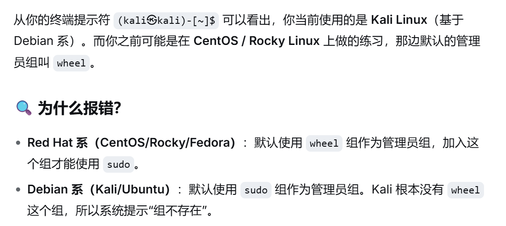
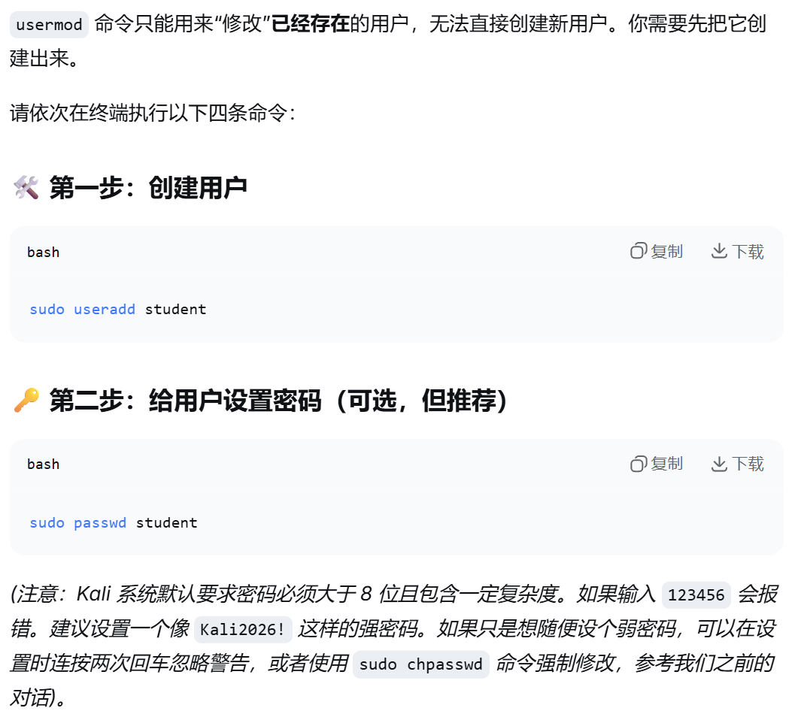
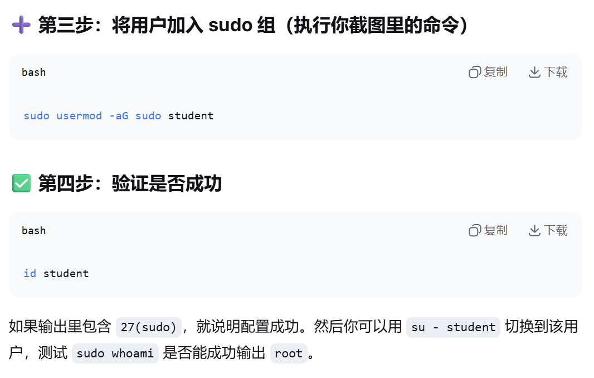

# Red Hat系(CentOS/Rocky/Fedora) :默认使用`wheel`组作为管理员组
## `sudo usermod -aG wheel student`
# Debian系(Kali/Ubuntu) :默认使用`sudo`作为管`理员组
## `sudo usermod -aG sudo student`

# 验证:`id student`

# 若没有`student`这个用户则先创建

