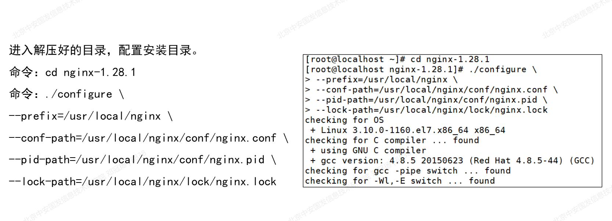
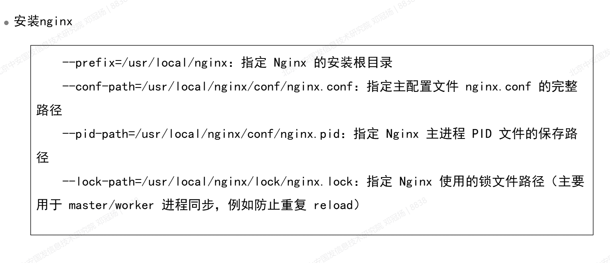

# 1、更新YUM源
# 安装服务器系统时,机器的默认源是国外地址,访问下载很容易访问超时、下载失败;需要给服务器配置一个国内源

# (1)首先备份原有镜像源
## `cp /etc/yum.repos.d/CentOS-Base.repo /etc/yum.repos.d/CentOS-Base.repo.bak`

# (2)下载Centos-7.repo文件
## `curl -o /etc/yum.repos.d/CentOS-Base.repo http://mirrors.aliyun.com/repo/Centos-7.repo`

# (3)清除yum缓存并缓存阿里云源
## `yum clean all` 
## `yum makecache`

# 2、安装Nginx
# (1)安装gcc
## 安装Nginx需要先将官网下载的源码进行编译,编译依赖gcc环境
## `yum install -y gcc-c++`

# (2)安装pcre pcre-devel
## `yum install -y pcre pcre-devel`

# (3)安装zlib
## `yum install -y zlib zlib-devel`

# (4)安装openssl
## `yum install -y openssl openssl-devel`

# (5)下载Nginx源码包(https://nginx.org/en/download.html)

# (6)上传源码到linux

# (7)解压源码
## `tar -zxvf nginx-1.28.1.tar.gz`

# (8)进入解压好的目录,配置安装目录
## `cd nginx-1.28.1`

# (9)编译
## `make`

# (10)编译安装
## `make install`

# (11)进入安装目录下的sbin目录,启动Nginx
## `cd /usr/local/nginx/sbin/`
## `./nginx`

# (12)开放防火墙端口
## `firewall-cmd --add-port=80/tcp --permanent`
## `firewall-cmd --reload`

# (13)检查防火墙端口开放情况
## `firewall-cmd --list-ports`

# (14)浏览器测试访问