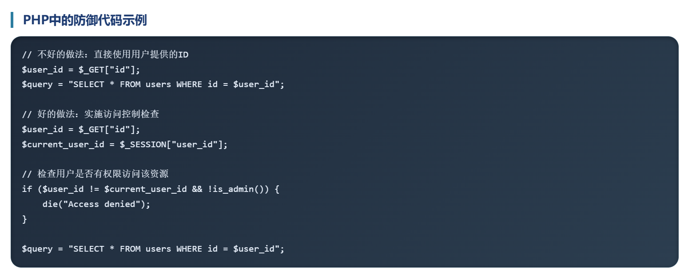

# IDOR(insecure Direct Object Reference) :不安全直接对象引用
## 当应用程序直接使用用户提供的输入来访问对象(如文件、数据库记录、用户账户等)时,没有进行适当的访问控制检查,导致攻击者可以访问未授权的资源

# 危害
## (1)访问其他用户的敏感数据
## (2)修改其他用户的账户信息
## (3)访问或下载未授权的文件
## (4)执行未授权的操作

# 防御
## (1)实施访问控制检查 :在访问任何资源时,验证用户是否有权限访问该资源
## (2)使用间接引用 :不直接使用数据库ID而是使用映射表或随机标识符
## (3)会话验证 :确保用户的会话与请求的资源匹配
## (4)输入验证 :对所有用户输入进行严格的验证
## (5)最小权限原则 :只授予用户必要的权限
## (6)使用HTTPS :保护传输中的数据
## (7)日志记录 :记录所有敏感操作,以便检测异常行为
