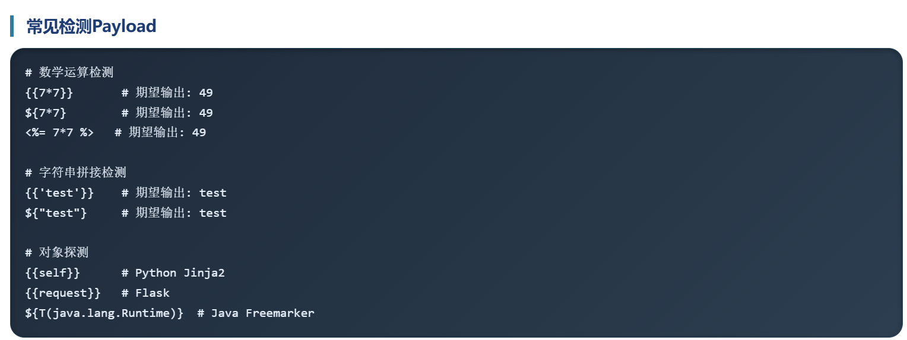

# SSTI(Server-Side Template Injection) :服务端模板注入
## 利用模板引擎的语法注入恶意payload,从而在服务器端执行任意代码

# 危害
## (1)远程代码执行(RCE)
## (2)读取敏感文件
## (3)获取服务器权限
## (4)数据泄露

# 常见模板引擎
## Python :Jinja2、Mako、Tornado 
### {{ }}、
## PHP :Twig、Smarty、Blade 
### {{ }}、{ }
## Java :Freemarker、Velocity、Thymeleaf 
### ${ }、#
## Node.js :EJS、Pug、Handlebars 
### <%= %>、#{ }

# 防御建议
## (1)输入验证 :对用户输入进行严格guolv,禁止模板语法
## (2)沙箱环境 :在受限的沙箱环境中执行模板渲染
## (3)白名单机制 :只允许预定义的变量和函数
## (4)避免动态渲染 :不要将用户输入直接作为模板内容
## (5)使用安全配置 :禁止危险函数和特性