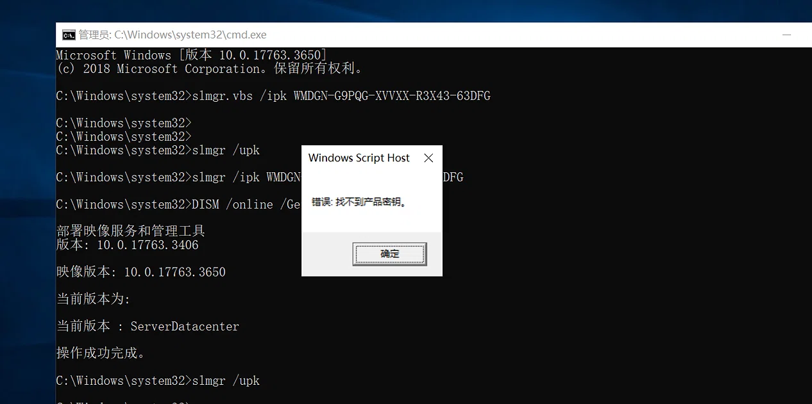
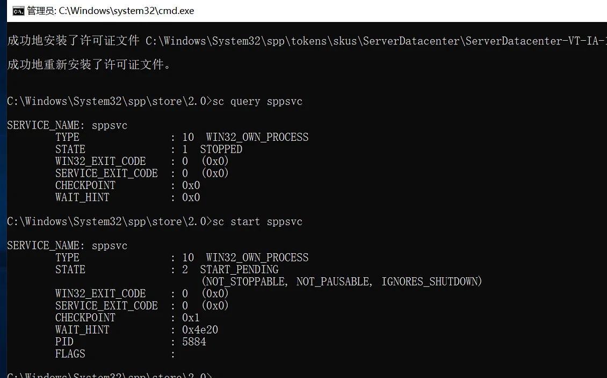
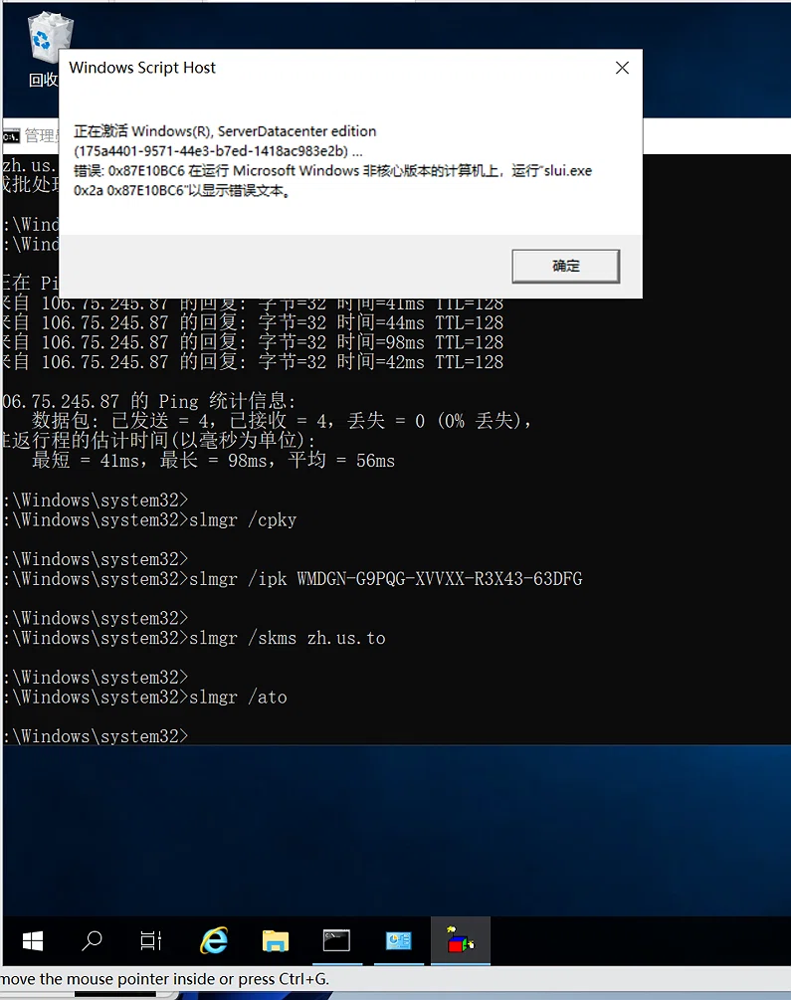
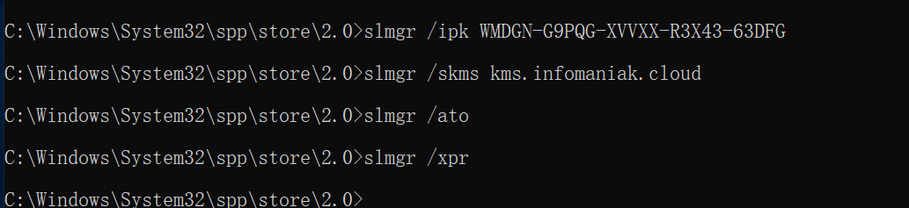

# Windows Server 2019激活
https://blog.csdn.net/sinat_38922095/article/details/157025391
https://blog.csdn.net/qq_40689436/article/details/136372155

# slmgr(Software License Manager)
# ipk(Install Product Key) :安装产品密钥
# skms(Set KMS Server) :设置KMS服务器
# KMS(Key Management Service) :密钥管理服务,微软专门为企业、学校、政府机构等大型组织设计的一种批量激活机制
# ato(Activate Online) :在线激活
# xpr(Expiration Check) :过期激活
# upk(Uninstall Product Key) :卸载产品密钥
# rilc(Reinstall Licenses) :重新安装许可证
# sc(Service Control) :服务控制管理器

# 管理员身份打开cmd

# `DISM /online /Get-CurrentEdition` :确认系统当前的真实版本
## DISM(Deployment Image Servicing and Management) :部署映像服务和管理工具
## /online :表示操作当前正在运行的操作系统(不是离线的镜像文件)
## /Get-CurrentEdition :获取当前版本

# `slmgr /upk` :清理旧密钥

## 当出现`找不到产品密钥`错误时,运行`net stop sppsvc && net start sppsvc`来重启服务

# `sc start sppsvc` :启动`Software Protection`服务
## 也可以`win+R` -> `service.msc` -> `Software Protection` -> `启动类型设置为自动或手动,再启动服务(可能是这里要手动启动服务)`
## 重置授权存储 
### `sc stop sppsvc` :强制停止服务
### `cd %windir%\system32\spp\store\2.0` :进入存储目录
### `ren tokens.dat tokens.bak` :重命名损坏文件
### `net start sppsvc` :重新启动服务
### `cscript.exe %windir%\system32\slmgr.vbs /rilc` :再次重建授权文件
# `sc query sppsvc` :确认服务是否启动

# 注意

## 当出现`密钥报错（0xC004E016）`这个报错时,是因为执行了`slmgr /upk`删除了密钥,导致sppsvc卡死;更换密钥用`slmgr /ipk`覆盖安装即可

# `slmgr /ipk WMDGN-G9PQG-XVVXX-R3X43-63DFG` :重新安装产品密钥
## `Datacenter` :数据中心版(WMDGN-G9PQG-XVVXX-R3X43-63DFG)
## `Standard` :N69G4-B89J2-4G8F4-WWYCC-J464C
## `Essentials` :WVDHN-86M7X-466P6-VHXV7-YY726

# `slmgr /skms kms.tencentyun.com` :指定KMS服务器

# `slmgr /ato` :执行激活请求

# `slmgr /xpr` :验证激活状态

# `slmgr /div` :查看包括密钥、KMS服务器地址、剩余激活天数等在内的完整信息

