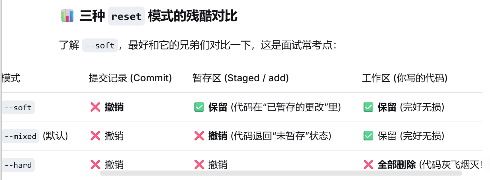

# `git reset --soft HEAD~1` 
## 要反悔上一步的提交但不想丢失已经写好了的代码;适用于不小心把代码提交了,但想反悔的情况
## `git reset` :重置(回退)
## `--soft` :软回退(灵魂);意思是只移动本库的指针(撤销提交记录),完全不动电脑里的代码,也不动暂存区(已add的状态)
## `HEAD~1` :代表上一个版本;HEAD永远指向当前所在的最新提交节点、~1就是往回倒一步

# `git reset HEAD~1` :不加任何参数默认是`--mixed`
## 撤销上一次的提交(Commit),并且把已经`git add`暂存的文件也退出了(取消暂存),保留代码不删

