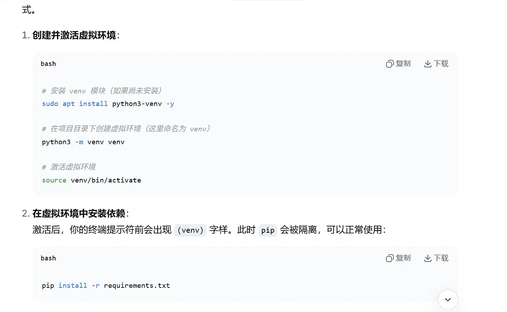
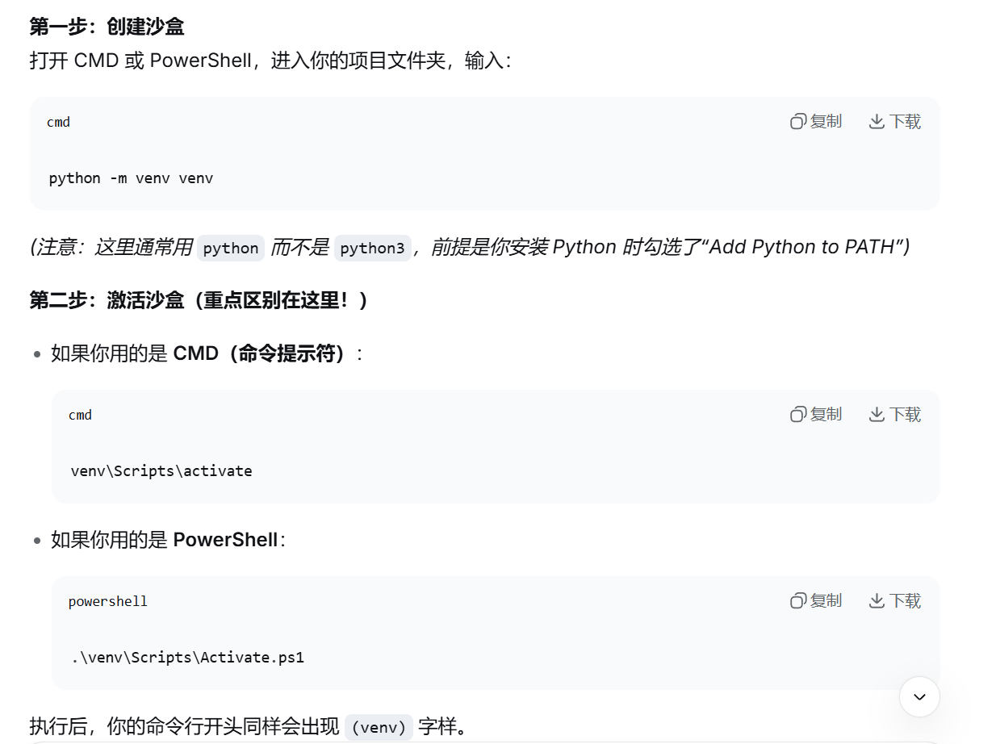

# 沙盒:虚拟环境(venv),"安全隔离"操作,在电脑里单独划出了一个"专属沙盒"(小房间)

# 安装虚拟环境模块
## Debian/Ubuntu/Kali :`sudo apt install python3-venv -y`
## CentOS/Rocky Linux/Fedora :`sudo dnf install python3`

# `python3 -m venv venv` :创建沙盒;后面那个venv可以随便改名
## Windows上要进入项目文件夹;Windows用的是python

# `source ven/bin/activate` :激活沙盒
## PowerShell要用管理员身份

# `pip install -r requirement.txt` :安装依赖

# `deactivate` :退出沙盒